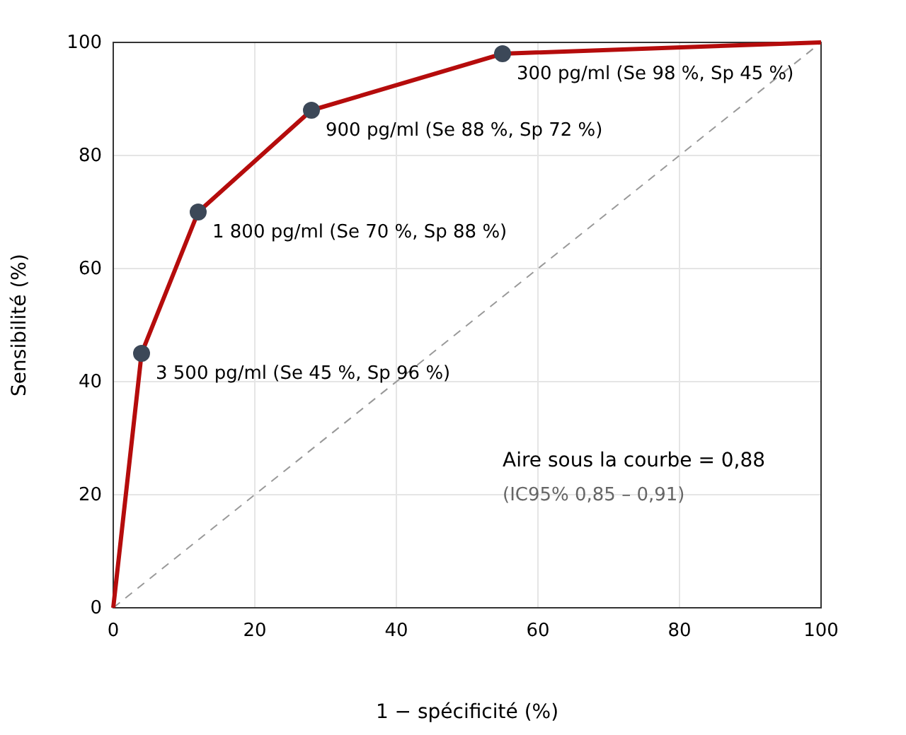
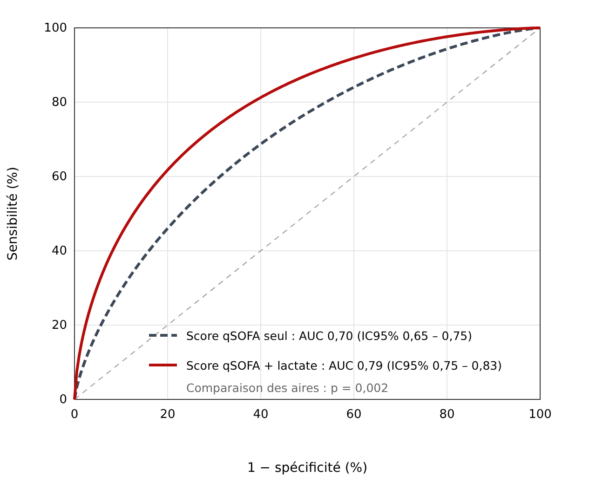
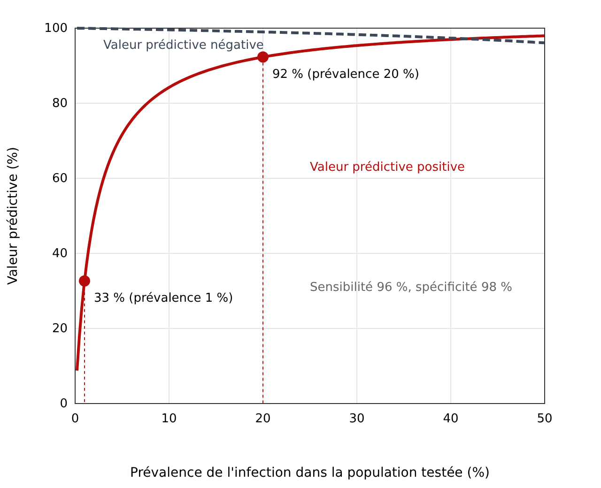
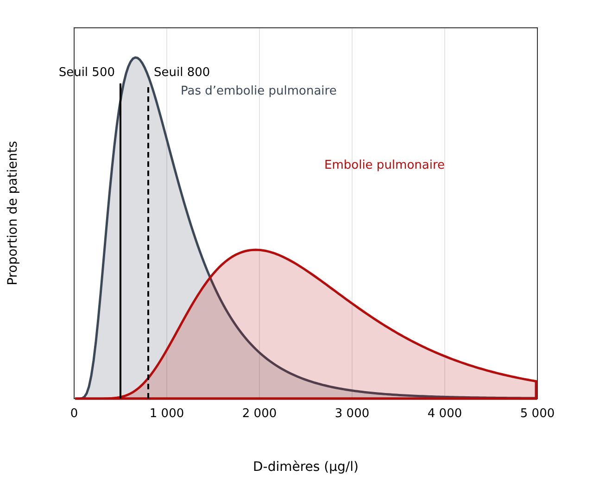
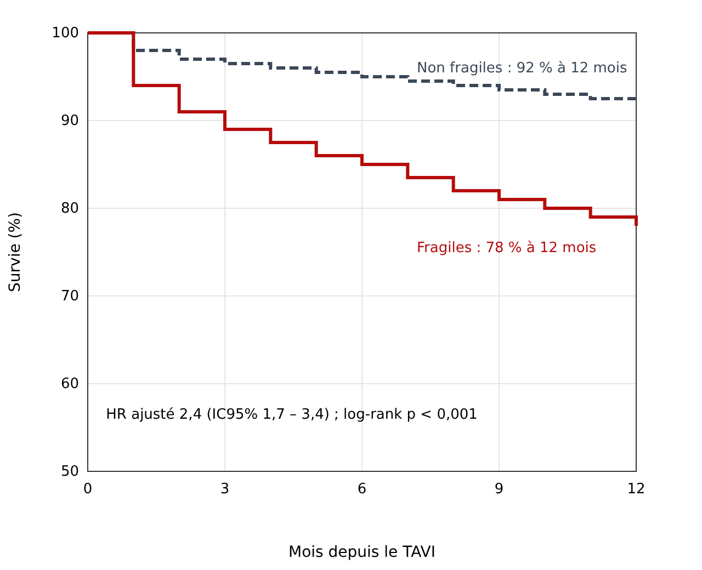

# Performances diagnostiques (figures)

> Format : ✅ = bonne réponse. Modifier librement le texte, les tableaux, les ✅ et les corrections, puis reconvertir avec `md2txt.py` pour l'export SIDES.

## QI 1 (QRM)

Une étude prospective évalue le dosage du NT-proBNP pour le diagnostic d'insuffisance cardiaque aiguë chez 700 patients consécutifs consultant aux urgences pour une dyspnée aiguë. Le diagnostic de référence (gold standard) est porté par deux cardiologues indépendants, sur le dossier complet incluant l'échocardiographie, sans connaître le résultat du NT-proBNP. Une insuffisance cardiaque aiguë est retenue chez 300 patients. La figure 1 présente la courbe ROC du dosage, avec la sensibilité (Se) et la spécificité (Sp) de quatre seuils.

Il est vrai que :

**A.** Le seuil de 300 pg/ml est le plus adapté pour éliminer une insuffisance cardiaque aiguë ✅
> Avec une sensibilité de 98 %, très peu de malades ont un résultat inférieur au seuil : c'est ce qu'on attend d'un test d'exclusion.

**B.** Au seuil de 1 800 pg/ml, le taux de faux positifs est de 12 % ✅
> Taux de faux positifs = faux positifs / non-malades = 1 − Sp = 1 − 0,88.

**C.** L'aire sous la courbe de 0,88 signifie que 88 % des patients sont correctement classés par le dosage
> L'aire sous la courbe est la probabilité qu'un malade tiré au sort ait un NT-proBNP plus élevé qu'un non-malade tiré au sort. La proportion de patients bien classés dépend du seuil choisi.

**D.** La valeur prédictive négative du dosage, à un seuil donné, dépend de la proportion de patients ayant une insuffisance cardiaque aiguë dans la population étudiée ✅
> Les valeurs prédictives varient avec la prévalence, contrairement à la sensibilité et à la spécificité qui se lisent sur la courbe ROC.

**E.** Choisir un seuil plus élevé augmente la sensibilité du dosage
> Un seuil plus élevé classe moins de patients positifs : la spécificité augmente et la sensibilité baisse (on remonte la courbe vers la gauche).

**Commentaire :** Piège d'annale visé : lecture d'une courbe ROC, choix du seuil selon l'objectif (exclure ou confirmer), aire sous la courbe et proportion de bien classés, taux de faux positifs = 1 − Sp (2018 ECNi endocan, 2019 ECNi épaule, 2024 EDN deep learning).

**Notion :** Études diagnostiques et pronostiques

---

## QI 2 (QRM)

Une cohorte prospective de 1 500 patients consultant aux urgences pour une suspicion de sepsis évalue la capacité du score qSOFA (fréquence respiratoire, conscience, pression artérielle systolique) à prédire la mortalité hospitalière, seul ou associé au dosage du lactate. La mortalité hospitalière est de 12 %. La figure 2 présente les deux courbes ROC.

Il est vrai que :

**A.** L'ajout du lactate améliore significativement la capacité du score à distinguer les patients qui décéderont de ceux qui survivront ✅
> Aire sous la courbe de 0,79 contre 0,70, différence significative (p = 0,002) : meilleure discrimination.

**B.** À spécificité égale, le score combiné a une sensibilité plus élevée que le qSOFA seul ✅
> La courbe du score combiné est au-dessus de l'autre pour toute valeur de 1 − Sp : à taux de faux positifs égal, elle détecte plus de décès.

**C.** Il s'agit d'une évaluation de performances diagnostiques du qSOFA pour détecter un sepsis sévère
> Le score prédit un événement futur (décès hospitalier) : c'est une évaluation pronostique.

**D.** Ce résultat suffit à recommander l'usage du score combiné dans tous les services d'urgences
> Il faut d'abord une validation externe (autres centres, autres populations), puis montrer que les décisions guidées par le score améliorent le devenir des patients.

**E.** La diagonale de la figure représente les performances du diagnostic de référence
> La diagonale représente un test non informatif (Se = 1 − Sp à chaque seuil), aire sous la courbe de 0,5.

**Commentaire :** Piège d'annale visé : comparaison de deux courbes ROC, valeur ajoutée d'un marqueur, diagnostic contre pronostic, étapes avant l'usage clinique, sens de la diagonale (2018 ECNi endocan, 2023 test sevrage de dialyse, 2022 test CRP).

**Notion :** Études diagnostiques et pronostiques

---

## QI 3 (QRM)

Une étude évalue la recherche de l'antigène urinaire du pneumocoque chez 400 adultes hospitalisés pour une pneumopathie communautaire. Le diagnostic de référence est composite (hémocultures, examen cytobactériologique des crachats et PCR sur prélèvement respiratoire). Le test urinaire est lu sans connaître le diagnostic de référence. Les auteurs rapportent : sensibilité 75 %, spécificité 95 %, valeur prédictive positive (VPP) 83 %, valeur prédictive négative (VPN) 92 %.

|  | Pneumocoque (référence +) | Pas de pneumocoque (référence −) | Total |
|---|---|---|---|
| Antigène urinaire + | 75 | 15 | 90 |
| Antigène urinaire − | 25 | 285 | 310 |
| Total | 100 | 300 | 400 |

Il est vrai que :

**A.** La sensibilité de 75 % signifie que le test est positif chez 75 % des patients ayant une pneumopathie à pneumocoque ✅
> Définition de la sensibilité : proportion de tests positifs chez les malades (75 / 100).

**B.** La VPN de 92 % signifie que 92 % des patients ayant un test négatif n'ont pas de pneumopathie à pneumocoque ✅
> Définition de la VPN : proportion de non-malades parmi les tests négatifs (285 / 310).

**C.** Un diagnostic de référence imparfait (cultures peu sensibles) peut fausser l'estimation des performances du test ✅
> Si la référence méconnaît des pneumocoques, de vrais positifs du test sont comptés comme faux positifs : la spécificité est sous-estimée.

**D.** Un antigène urinaire négatif permet d'éliminer une pneumopathie à pneumocoque
> Avec une sensibilité de 75 %, un quart des pneumocoques ont un test négatif : un test négatif n'élimine pas le diagnostic.

**E.** La spécificité de 95 % signifie que 95 % des patients ayant un test positif ont une pneumopathie à pneumocoque
> C'est la définition de la VPP (ici 83 %). La spécificité est la proportion de tests négatifs chez les patients sans pneumocoque (285 / 300).

**Commentaire :** Piège d'annale visé : définitions de Se, Sp, VPP et VPN à partir d'un tableau 2 x 2, confusion spécificité / VPP, diagnostic de référence imparfait (2019 ECNi épaule, 2021 test coroscanner, 2024 EDN deep learning).

**Notion :** Études diagnostiques et pronostiques

---

## QI 4 (QRU)

Un test rapide d'orientation diagnostique (TROD) de l'infection par le virus de l'hépatite C a une sensibilité de 96 % et une spécificité de 98 %. La figure 3 présente ses valeurs prédictives en fonction de la prévalence de l'infection dans la population testée. Quelle est la proposition exacte ?

**A.** La sensibilité du TROD diminue quand la prévalence de l'infection diminue
> La sensibilité et la spécificité sont des caractéristiques du test, indépendantes de la prévalence : seules les valeurs prédictives varient.

**B.** Dans une population où la prévalence est de 1 %, la majorité des TROD positifs sont des faux positifs ✅
> La VPP lue sur la figure est de 33 % : deux TROD positifs sur trois sont des faux positifs.

**C.** Dans une population où la prévalence est de 1 %, la valeur prédictive négative est trop basse pour rassurer une personne dont le TROD est négatif
> La VPN est proche de 100 % aux faibles prévalences : un TROD négatif est rassurant.

**D.** Dans une population où la prévalence est de 20 %, la valeur prédictive positive est égale à la spécificité
> Elle est de 92 % sur la figure ; l'égalité avec la spécificité serait une coïncidence, pas une règle.

**E.** Dans une population où la prévalence est de 1 %, un TROD positif suffit à annoncer le diagnostic d'hépatite C
> Avec une VPP d'un tiers, un TROD positif impose une confirmation (sérologie, puis charge virale).

**Commentaire :** Piège d'annale visé : effet de la prévalence sur la VPP et la VPN, Se et Sp indépendantes de la prévalence (2019 ECNi épaule, 2018 ECNi endocan, 2017 complémentaires Göteborg).

**Notion :** Études diagnostiques et pronostiques

---

## QI 5 (QRM)

Une étude porte sur 1 200 patients de 80 ans et plus consultant pour une suspicion d'embolie pulmonaire avec une probabilité clinique non forte. Tous ont un dosage des D-dimères et un diagnostic de référence (angioscanner ou suivi à 3 mois). La figure 4 montre la distribution des D-dimères chez les patients avec et sans embolie pulmonaire. Deux seuils sont comparés : 500 µg/l (seuil classique) et 800 µg/l (seuil ajusté à l'âge, âge × 10).

| Seuil | Sensibilité | Spécificité |
|---|---|---|
| 500 µg/l | 99,9 % | 14 % |
| 800 µg/l | 99,3 % | 42 % |

Il est vrai que :

**A.** Passer du seuil de 500 au seuil de 800 µg/l diminue le nombre de faux positifs ✅
> Les patients sans embolie dont les D-dimères sont entre 500 et 800 µg/l deviennent négatifs : la spécificité passe de 14 % à 42 %.

**B.** Passer du seuil de 500 au seuil de 800 µg/l augmente le nombre de faux négatifs ✅
> La petite partie de la distribution des embolies située entre 500 et 800 µg/l devient négative : la sensibilité baisse légèrement.

**C.** Le chevauchement des deux distributions explique qu'aucun seuil ne sépare parfaitement les patients avec et sans embolie pulmonaire ✅
> Quel que soit le seuil, il reste des faux positifs, des faux négatifs ou les deux.

**D.** Au seuil de 500 µg/l, un résultat négatif ne permet pas d'exclure l'embolie pulmonaire chez ces patients
> Avec une sensibilité de 99,9 %, un résultat négatif exclut l'embolie ; le problème du seuil classique chez le sujet âgé est qu'il est rarement négatif (spécificité de 14 %).

**E.** Le choix du seuil de 800 µg/l modifie la prévalence de l'embolie pulmonaire dans la population étudiée
> La prévalence dépend de la population, pas du seuil du test.

**Commentaire :** Piège d'annale visé : relation entre seuil, sensibilité et spécificité, chevauchement des distributions, utilité d'un test d'exclusion (2018 ECNi endocan, 2019 ECNi épaule, 2024 EDN deep learning).

**Notion :** Études diagnostiques et pronostiques

---

## QI 6 (QRM)

Un algorithme d'intelligence artificielle classe des images de dermatoscopie en « mélanome » ou « lésion bénigne ». Le diagnostic de référence est l'examen anatomopathologique de la lésion excisée. Le seuil de positivité a été choisi sur le jeu de développement en maximisant l'indice de Youden (Se + Sp − 1).

| Jeu de données | Origine | Lésions (dont mélanomes) | Aire sous la courbe ROC [IC95%] | Se | Sp |
|---|---|---|---|---|---|
| Développement | 4 centres allemands, 2015-2021 | 18 000 (1 800) | non applicable | non applicable | non applicable |
| Validation interne | 20 % tirés au sort dans les mêmes centres | 4 500 (450) | 0,95 [0,94 – 0,96] | 92 % | 88 % |
| Validation externe | 3 centres australiens, 2023 | 2 000 (160) | 0,85 [0,82 – 0,88] | 84 % | 74 % |

Il est vrai que :

**A.** La baisse des performances en validation externe montre que la validation interne surestimait les performances de l'algorithme ✅
> Des images issues des mêmes centres (mêmes appareils, mêmes patients, mêmes pratiques) donnent une estimation optimiste.

**B.** La validation externe donne une meilleure idée des performances attendues dans une autre population ✅
> C'est l'étape indispensable avant tout usage hors des centres de développement.

**C.** La différence de performances peut s'expliquer par des populations différentes, par exemple les phototypes ou les appareils de dermatoscopie ✅
> Le spectre des patients et les conditions techniques changent entre les deux jeux.

**D.** Un algorithme d'intelligence artificielle peut avoir de meilleures performances que l'examen anatomopathologique qui sert à l'évaluer
> Les performances sont mesurées par rapport à la référence : par construction, l'algorithme ne peut pas la dépasser.

**E.** Un jeu de validation tiré au sort dans la même base de données protège d'une estimation optimiste des performances
> Le tirage au sort ne crée pas d'indépendance vis-à-vis des centres : seule une validation externe le permet. Le choix du seuil sur les données de développement ajoute à l'optimisme.

**Commentaire :** Piège d'annale visé : validation interne contre externe, optimisme du seuil choisi sur les données, « l'algorithme dépasse le gold standard » (2024 EDN deep learning, 2018 ECNi endocan, 2023 test sevrage de dialyse).

**Notion :** Études diagnostiques et pronostiques

---

## QI 7 (QRM)

Une étude évalue l'électrocardiogramme (ECG) d'effort pour le diagnostic de maladie coronaire chez 500 patients consultant pour une douleur thoracique. Le diagnostic de référence est la coronarographie. Elle n'a été réalisée que lorsque le cardiologue l'a jugée utile, et les performances sont calculées chez les seuls patients ayant eu une coronarographie : les auteurs rapportent une sensibilité de 89 % et une spécificité de 57 %.

| Résultat de l'ECG d'effort | Patients | Coronarographie réalisée | Sténose significative à la coronarographie |
|---|---|---|---|
| Positif | 200 | 180 | 120 |
| Négatif | 300 | 60 | 15 |

Il est vrai que :

**A.** La coronarographie a été réalisée beaucoup plus souvent après un ECG d'effort positif qu'après un ECG d'effort négatif ✅
> 180 patients sur 200 après un ECG positif, contre 60 sur 300 après un ECG négatif.

**B.** Cette étude est exposée à un biais de vérification ✅
> Le diagnostic de référence n'a pas été appliqué de la même façon selon le résultat du test : 90 % des tests positifs ont été vérifiés, contre 20 % des tests négatifs.

**C.** Ce biais tend à surestimer la sensibilité de l'ECG d'effort ✅
> Les faux négatifs, rarement vérifiés, échappent au calcul : la sensibilité est gonflée (environ 64 % si l'on extrapole aux patients non vérifiés).

**D.** Ce biais aurait disparu avec un effectif plus grand
> Un biais ne dépend pas de l'effectif ; la parade est d'appliquer la référence à tous les patients, quel que soit le résultat du test.

**E.** Ce biais tend aussi à surestimer la spécificité de l'ECG d'effort
> Il la sous-estime : les vrais négatifs, rarement vérifiés, manquent au calcul (environ 77 % si l'on extrapole aux patients non vérifiés, contre 57 % rapportés).

**Commentaire :** Piège d'annale visé : biais de vérification, référence appliquée à tous et indépendamment du test, sens du biais (2021 test coroscanner, 2019 ECNi épaule, 2024 EDN deep learning).

**Notion :** Études diagnostiques et pronostiques ; Biais de sélection, d'information, de classement

---

## QI 8 (QRM)

Les performances de l'échographie veineuse de compression pour le diagnostic de thrombose veineuse profonde (TVP) des membres inférieurs ont été évaluées dans deux populations, avec la phlébographie comme diagnostic de référence.

| Population | Patients | TVP | Se [IC95%] | Sp [IC95%] |
|---|---|---|---|---|
| Consultation pour suspicion de TVP (symptomatiques) | 400 | 120 | 95 % [90 – 98] | 97 % [94 – 99] |
| Dépistage systématique à J8 d'une prothèse de hanche (asymptomatiques) | 600 | 90 | 60 % [50 – 70] | 97 % [95 – 98] |

Il est vrai que :

**A.** La différence de sensibilité peut s'expliquer par le type de thromboses : les TVP asymptomatiques sont souvent plus petites et plus distales ✅
> Biais de spectre : la sensibilité dépend des formes de la maladie présentes dans l'échantillon.

**B.** Ce résultat est impossible car la sensibilité est une caractéristique intrinsèque du test
> La sensibilité ne dépend pas de la prévalence, mais elle dépend du spectre de la maladie : un même test détecte moins bien les formes débutantes ou peu étendues.

**C.** Les performances d'un test doivent être estimées dans la population où il sera utilisé ✅
> La sensibilité de 95 % ne s'applique qu'aux patients symptomatiques.

**D.** Chez un patient asymptomatique après prothèse de hanche, une échographie négative suffit à exclure une TVP
> Avec une sensibilité de 60 %, 4 TVP sur 10 ne sont pas vues.

**E.** La spécificité étant identique dans les deux populations, le test a la même utilité pour le dépistage après chirurgie que pour le diagnostic chez les patients symptomatiques
> C'est la sensibilité qui compte pour exclure, et elle est bien plus faible dans le dépistage.

**Commentaire :** Piège d'annale visé : biais de spectre, Se et Sp « intrinsèques » mais dépendantes de la population, population cible du test (2021 test coroscanner, 2019 ECNi épaule, 2024 EDN deep learning).

**Notion :** Études diagnostiques et pronostiques

---

## QI 9 (QRU)

Une étude évalue la bandelette urinaire chez 600 femmes consultant pour des signes fonctionnels urinaires, par rapport à l'examen cytobactériologique des urines (diagnostic de référence). Deux critères de positivité sont étudiés séparément.

| Critère de positivité | Sensibilité | Spécificité |
|---|---|---|
| Nitrites positifs | 50 % | 98 % |
| Leucocytes positifs | 85 % | 70 % |

Quel critère est le plus adapté pour confirmer une infection urinaire, et pourquoi ? Quelle est la proposition exacte ?

**A.** Les leucocytes, car leur sensibilité est plus élevée
> Une sensibilité élevée sert à éliminer une maladie (peu de faux négatifs), pas à la confirmer.

**B.** Les nitrites, car leur spécificité élevée implique peu de faux positifs ✅
> Pour confirmer, il faut qu'un test positif soit rarement observé chez les non-malades. Rapport de vraisemblance positif : nitrites 0,50 / 0,02 = 25 ; leucocytes 0,85 / 0,30 = 2,8.

**C.** Les deux critères sont équivalents, puisqu'ils sont lus sur la même bandelette
> Leurs profils sont opposés : les nitrites servent plutôt à confirmer, les leucocytes plutôt à éliminer.

**D.** Les nitrites, car leur valeur prédictive négative est la plus élevée
> Avec une sensibilité de 50 %, la VPN des nitrites est la plus faible ; ce sont les leucocytes qui serviraient à éliminer.

**E.** Les nitrites, car leur sensibilité est plus élevée que celle des leucocytes
> Elle est plus faible (50 % contre 85 %) ; c'est leur spécificité qui en fait le meilleur critère de confirmation.

**Commentaire :** Piège d'annale visé : sensibilité pour éliminer, spécificité pour confirmer (2019 ECNi épaule, 2018 ECNi endocan).

**Notion :** Études diagnostiques et pronostiques

---

## QI 10 (QRM)

Une cohorte prospective de 900 patients traités par implantation percutanée d'une valve aortique (TAVI) évalue un score de fragilité mesuré avant l'intervention ; 300 patients sont classés fragiles. La figure 5 présente la survie selon le statut de fragilité (méthode de Kaplan-Meier). L'aire sous la courbe ROC du score pour prédire le décès à 1 an est de 0,68 [IC95% 0,63 – 0,73].

Il est vrai que :

**A.** Le score de fragilité est utilisé ici comme un marqueur pronostique ✅
> Il prédit un événement futur (décès) chez des patients dont le diagnostic est déjà connu.

**B.** La survie à 12 mois est plus faible chez les patients fragiles que chez les patients non fragiles ✅
> Lecture de la figure : 78 % contre 92 % à 12 mois.

**C.** Une aire sous la courbe de 0,68 traduit une capacité de discrimination modeste, insuffisante pour décider seule chez un patient ✅
> Le score distingue imparfaitement les patients qui décéderont dans l'année de ceux qui survivront.

**D.** Ce résultat démontre qu'il faut renoncer au TAVI chez les patients fragiles
> Il montre un pronostic plus sombre, pas l'absence de bénéfice du TAVI ; seul un essai comparant les décisions guidées par le score pourrait le montrer.

**E.** La décroissance des courbes de survie est due en partie aux patients perdus de vue
> Une courbe de Kaplan-Meier ne décroît qu'aux décès ; les perdus de vue sont censurés et réduisent seulement les effectifs à risque.

**Commentaire :** Piège d'annale visé : marqueur pronostique, lecture d'une courbe de Kaplan-Meier, aire sous la courbe et décision individuelle, « la courbe décroît à cause des perdus de vue » (2023 test sevrage de dialyse, 2018 ECNi endocan, 2022 ECNi consultation pluridisciplinaire).

**Notion :** Études diagnostiques et pronostiques

---
